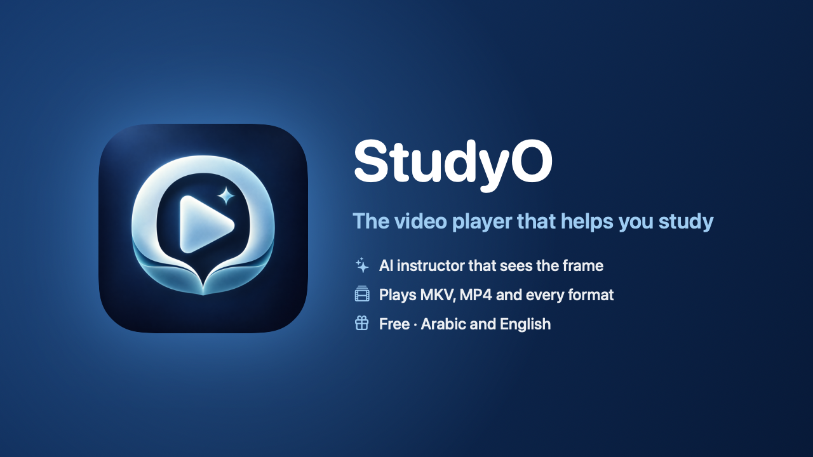
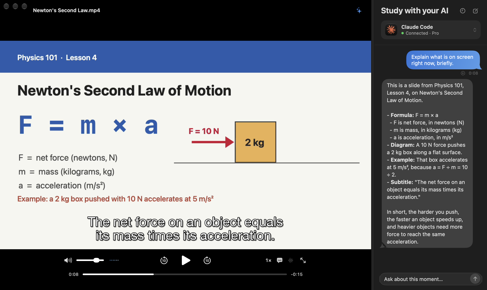
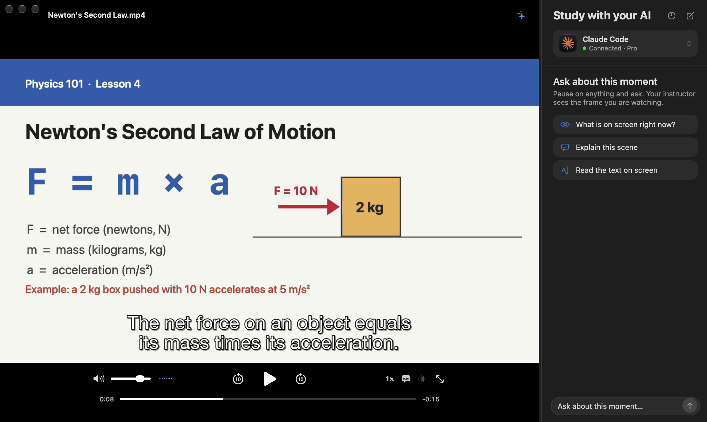
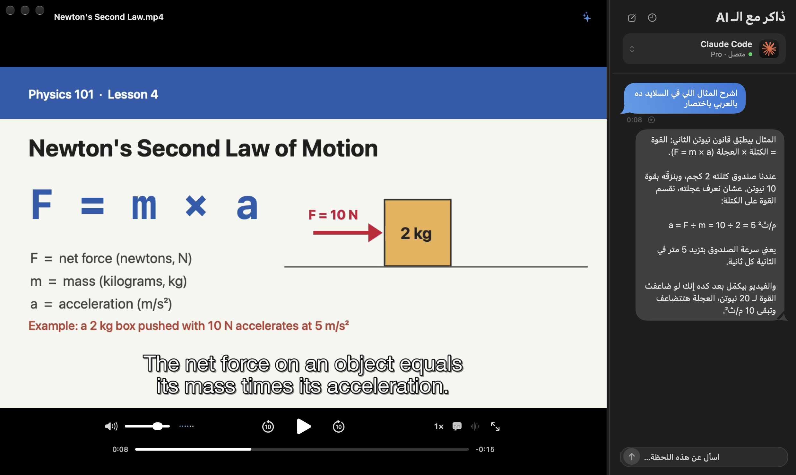
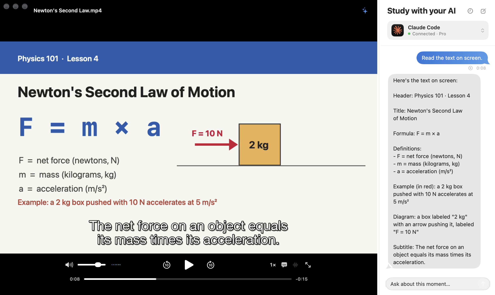
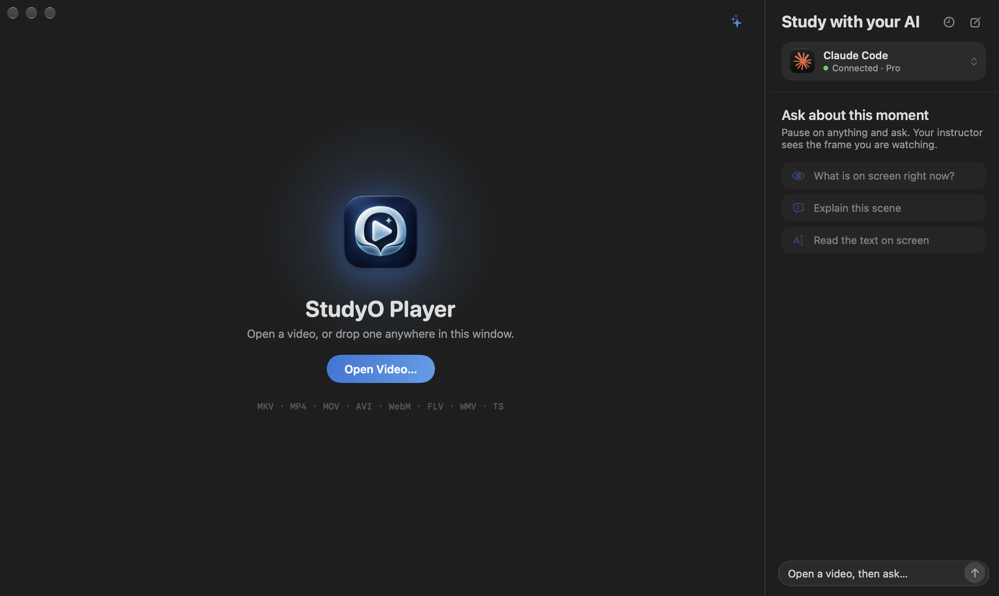
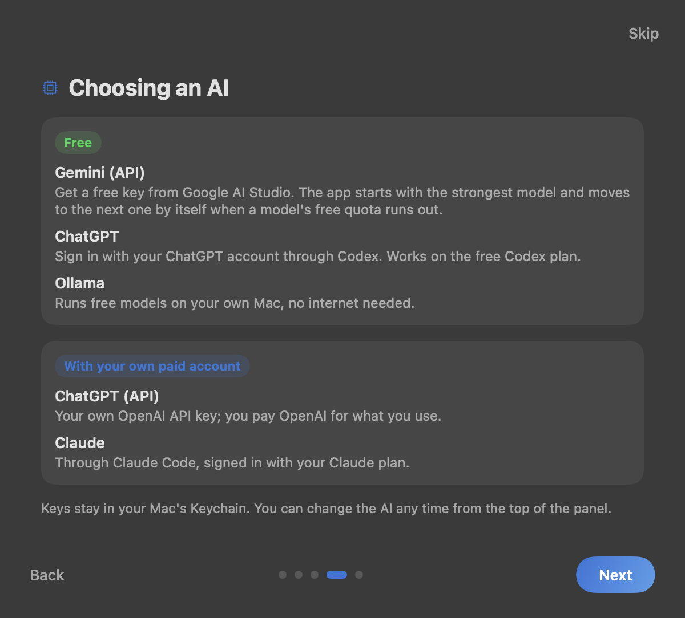
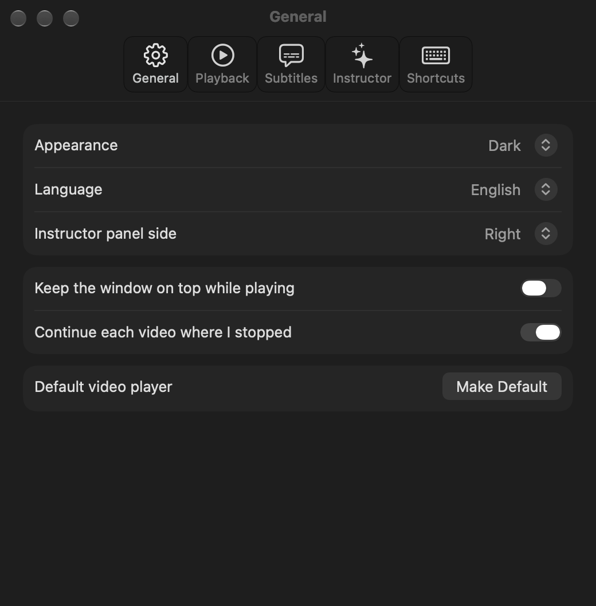

<p align="center">
  
</p>

# StudyO Player

**A free Mac video player with an AI instructor beside the video.** Pause on any moment of a
lecture or course and ask about it: the AI sees the exact frame on your screen and reads the
subtitles around it, then explains.

<p align="center">
  
</p>

## Features

**Plays practically everything**
- MKV, MP4, MOV, AVI, WebM, FLV, WMV, TS and more, through the VLC engine. Nothing else to install.
- Subtitle files (`.srt`, `.ass`, `.vtt`), multiple audio tracks, speeds from 0.5× to 3×.
- Picks up where you stopped in every video.

**An AI instructor that sees what you see**
- Ask "Explain this scene", "Read the text on screen", or anything else.
- Each question carries the current frame, the playback time and the nearby subtitle lines.
- Every video keeps its own chat, and it comes back when you open the video again.
- Answers in Arabic or English, whichever you ask in.

**Use the AI you already have**

| | AI | How |
| --- | --- | --- |
| Free | Gemini | A free API key from Google AI Studio. StudyO starts with the strongest model and steps down by itself when one runs out of free quota. |
| Free | ChatGPT | Sign in with your ChatGPT account through Codex. |
| Free | Ollama | Models running on your own Mac, no internet needed. |
| Paid | ChatGPT API | Your own OpenAI API key. |
| Paid | Claude | Through Claude Code, with your Claude plan. |

**Made for the Mac**
- Built for Apple silicon. Arabic and English interface, light and dark mode.
- Touch Bar: play/pause, a strip of frames to scrub through, live sound bars.
- Trackpad: spread two fingers for full screen, pinch to leave.

## Screenshots

| | |
| --- | --- |
|  |  |
| Pause on any moment and ask | Fully Arabic, right to left |
|  |  |
| Light and dark mode | Open a video or drop one in |
|  |  |
| Free and paid AI choices | Settings |

## Install

1. Download the latest `StudyO-x.y.dmg` from the [Releases](../../releases) page.
2. Open it and drag **StudyO** into **Applications**.
3. The first time you open it, macOS may say it cannot verify the app (it is not notarized yet).
   Open **System Settings → Privacy & Security**, scroll down and click **Open Anyway**. Once is enough.

**Requirements:** a Mac with Apple silicon (M1 or later) and macOS 14 Sonoma or newer.
The AI features need one of the AIs in the table above.

## Privacy

StudyO has no account, no analytics and no tracking. Your chats stay on your Mac, API keys stay
in the macOS Keychain, and a question goes only to the AI you connected. Captured frames are
deleted right after each question.

## Keyboard shortcuts

Space play/pause · ←/→ skip · ↑/↓ volume · F full screen · M mute · ⌘O open · ⌘B show/hide the AI panel

---

## For developers

### Build and run

```bash
./build.sh --run        # build, then open the app
./build.sh --install    # build, then copy to /Applications
./build.sh --dmg        # build, then make build/StudyO-<version>.dmg for sharing
```

Needs Apple Command Line Tools (`swiftc`). The video engine (libVLC 3) is kept in `Engine/vlc`
and copied into `build/StudyO.app`, so the built app runs on its own. `Engine/` is not in git: on
a fresh clone, install VLC.app **3.x** (Apple silicon or Universal) once, and the first build
copies its engine into `Engine/vlc`; after that VLC.app is no longer needed. The build stops if another VLC series is installed (the live audio level relies on
libVLC 3). The app is built for Apple silicon only.

### Layout

| File | What it does |
| --- | --- |
| `Sources/StudyOPlayer/StudyOPlayerApp.swift` | App entry, menus, keyboard shortcuts, self-test |
| `Sources/StudyOPlayer/PlayerModel.swift` | libvlc wrapper: open, play, seek, tracks, frame snapshot |
| `Sources/StudyOPlayer/ContentView.swift` | Main window: video area, control bar, drag and drop |
| `Sources/StudyOPlayer/AISidebar.swift` | AI panel: AI picker, chat, input |
| `Sources/StudyOPlayer/AIModel.swift` | Chat state, the prompt sent to the AI, subtitle reading |
| `Sources/StudyOPlayer/AIProviders.swift` | Finds AIs on the Mac and runs them |
| `Sources/StudyOPlayer/CloudAI.swift` | ChatGPT / Gemini by API key, Keychain, saved chats |
| `Sources/StudyOPlayer/Onboarding.swift` | Welcome tour |
| `Sources/StudyOPlayer/DefaultPlayer.swift` | "Open videos with StudyO by default?" prompt |
| `Sources/StudyOPlayer/AudioMeter.swift` | Live sound bars (control panel and Touch Bar) |
| `Sources/StudyOPlayer/TouchBar.swift`, `Thumbnails.swift` | Touch Bar and its frame strip |
| `Sources/StudyOPlayer/Settings.swift` | Preferences and the Settings window |
| `Sources/StudyOPlayer/L10n.swift` | Arabic / English strings |
| `Sources/CVLC/vlc_min.h` | The libvlc C functions the app uses |

To add another AI: add a case to `AIProvider.Kind`, detect it in `AIDetector.detect()`, and build
its command in `AIModel.askCLI`.

### Security

- Signed with the hardened runtime; macOS refuses to run the app if a signed file is changed.
- Local files only. Network, streaming-out, capture, remote-control, scripting and password
  modules of the video engine are removed at build time (see `REMOVE` in `build.sh`).
- Claude runs with all tools off (no file access, no commands, no MCP); the frame goes over stdin.
  Codex runs in its read-only sandbox. Gemini CLI gets a workspace setting that switches off its
  shell, file-writing and web tools.
- Questions, file names and subtitles reach CLI tools through stdin, never on the command line,
  and are fenced as data so text inside a video cannot steer the AI.
- AI tools are launched only if owned by you or root and not writable by others, with a minimal
  environment.
- Not sandboxed (it has to launch the AI tools) and not notarized yet (needs an Apple Developer ID).

### Self-test

Only in builds made with `./build.sh --selftest`:

```bash
STUDYO_SELFTEST="What is on screen?" STUDYO_SELFTEST_FILE=/path/to/video.mkv \
  "build/StudyO.app/Contents/MacOS/StudyOPlayer"
```

Plays the file, asks the selected AI, prints the answer, and quits. Other modes:

- `STUDYO_SELFTEST_GALLERY=<folder>` with `STUDYO_SELFTEST_FILE` — takes the README screenshots.
- `STUDYO_SELFTEST_FIXES=/path/video` — seek after the end, Stop before the tool starts, new chat
  during an answer.
- `STUDYO_SELFTEST_AUDIO=/path/tone.wav` — measures how far the level reading leads the sound.

## Licence

© 2026 MT Technologies. Free to download and use; see [LICENSE.md](LICENSE.md). The bundled video
engine comes from VLC (LGPL/GPL parts), and publishing builds means following those licences.
